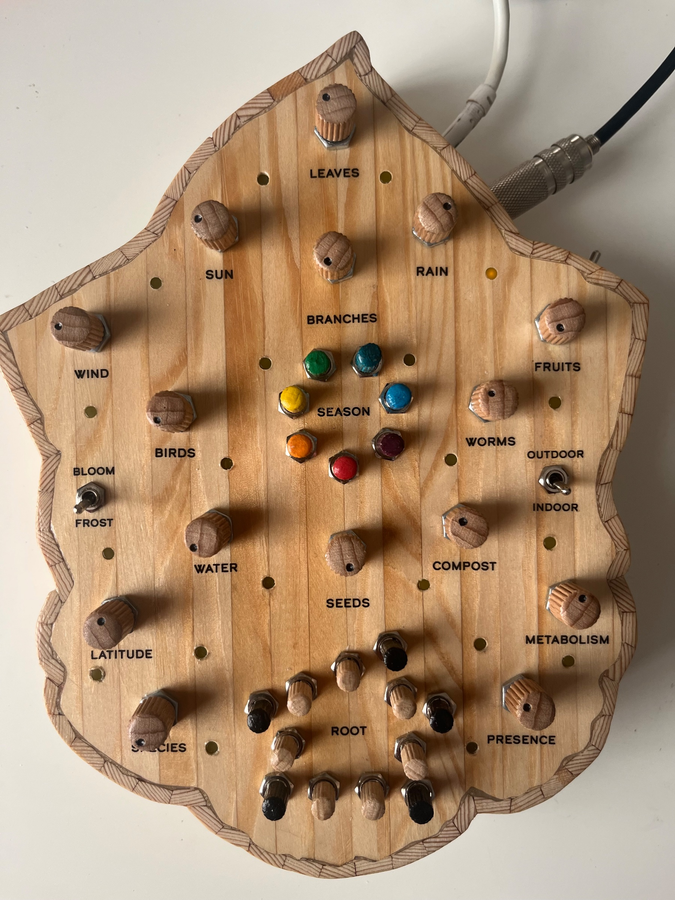
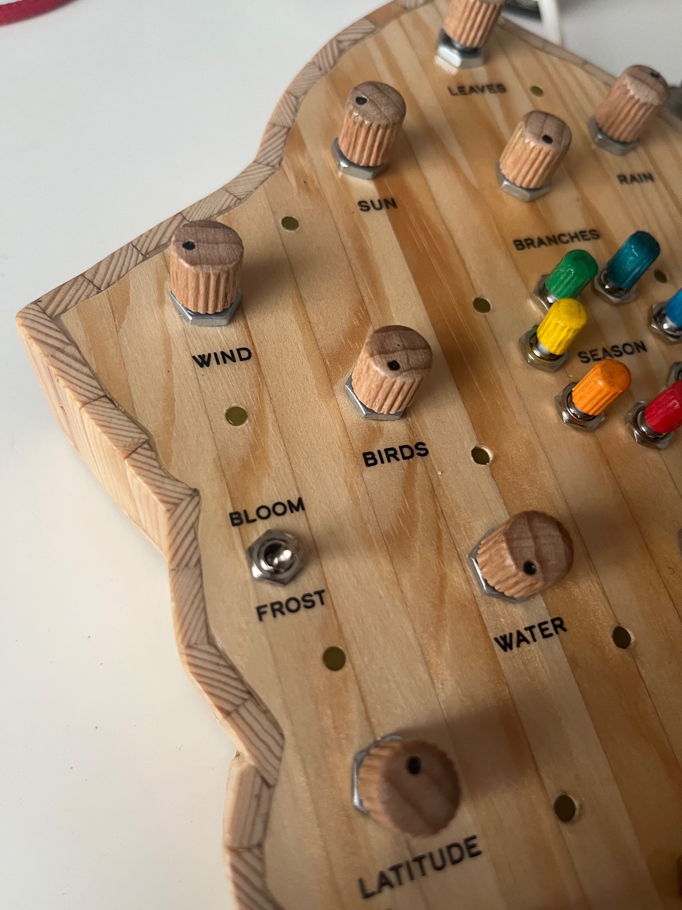
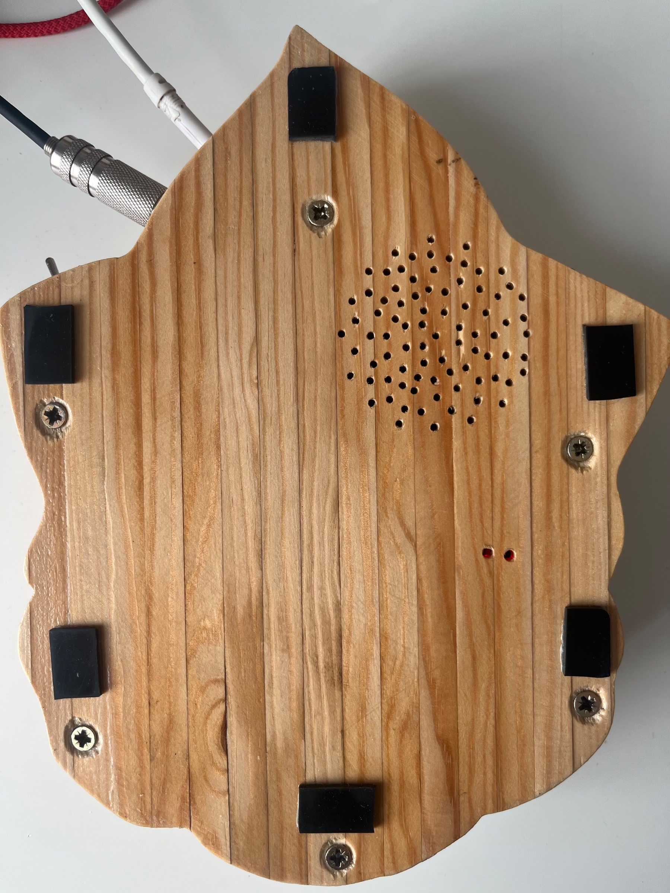
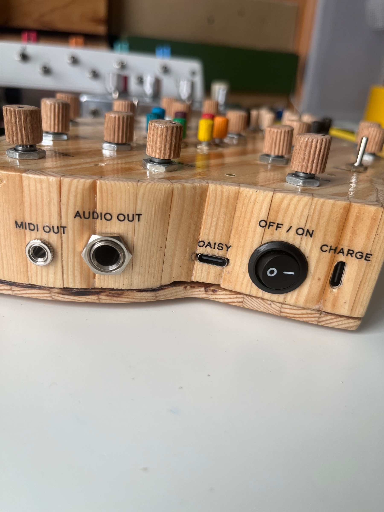
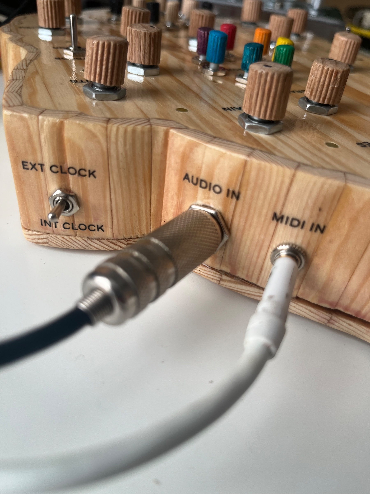
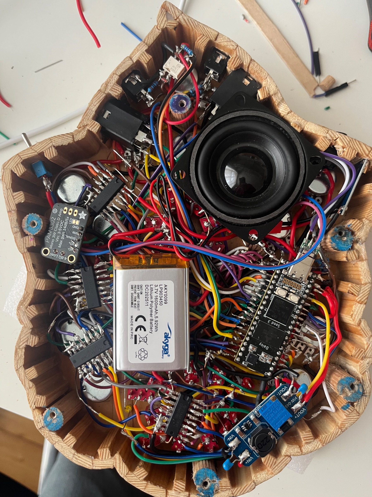

Avrei potuto dedicarmi a programmare un firmware per un sintetizzatore tascabile qualsiasi, invece ho trascorso gli ultimi 2 mesi a creare questa nuova macchina.

Interamente programmato in [plugdata](https://plugdata.org/).

Può generare melodie complesse basate su una serie di parametri, secondo una metafora di crescita delle piante.

Tutti i LED sono collegati direttamente a Daisy, mentre i pulsanti, i potenziometri e gli interruttori utilizzano 5 multiplexer (cd4021be).

Ingresso/uscita audio; ingresso/uscita MIDI; batteria ai polimeri di litio; altoparlante interno.

Super portatile, super divertente.
Adoro questo framework plugdata-daisy: dall'idea al completamento mi ci sono voluti meno di 2 mesi.
E questa volta ho risparmiato sui cappucci delle manopole e sull'involucro 😁

Ecco una demo abbastanza lunga: https://youtu.be/T42-izEglRY?is=iK7CzBEPWlqaweoR

Ecco un mini video di Instagram: https://www.instagram.com/reel/DerdN2dCbWS/?obrf=YWo0eGI0ZGZha2N1

