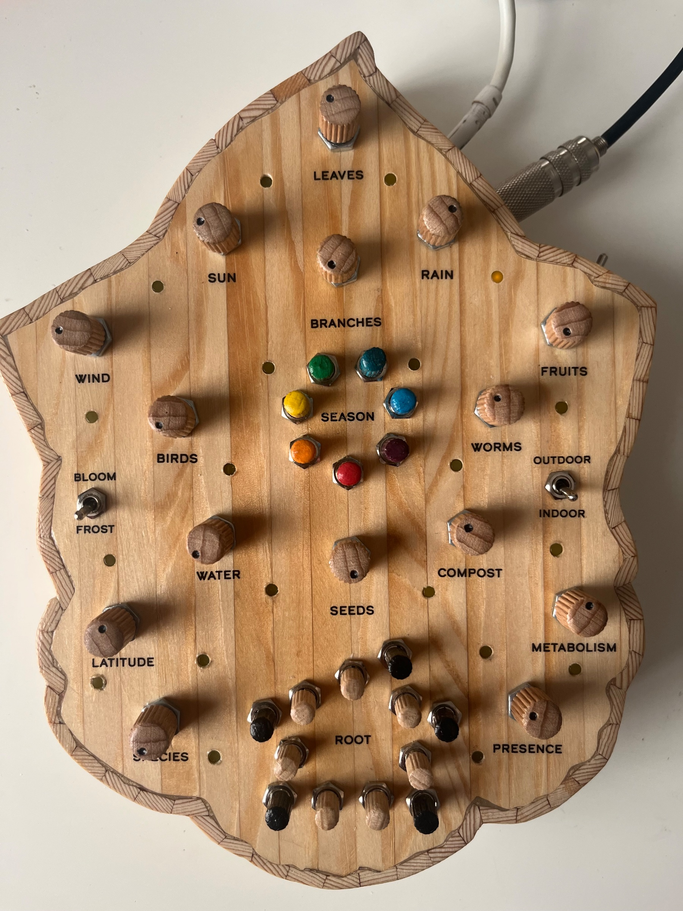
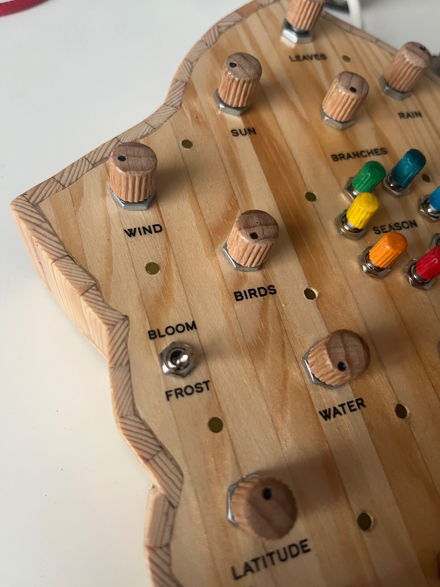
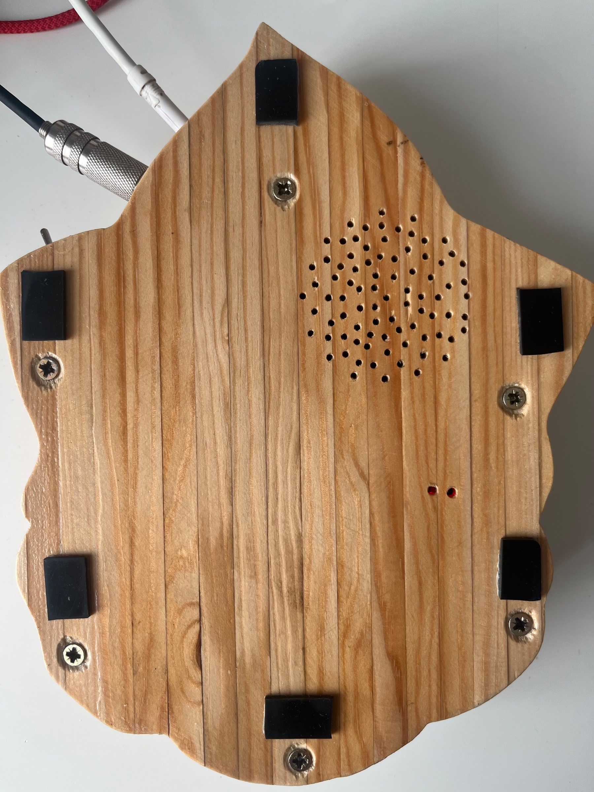
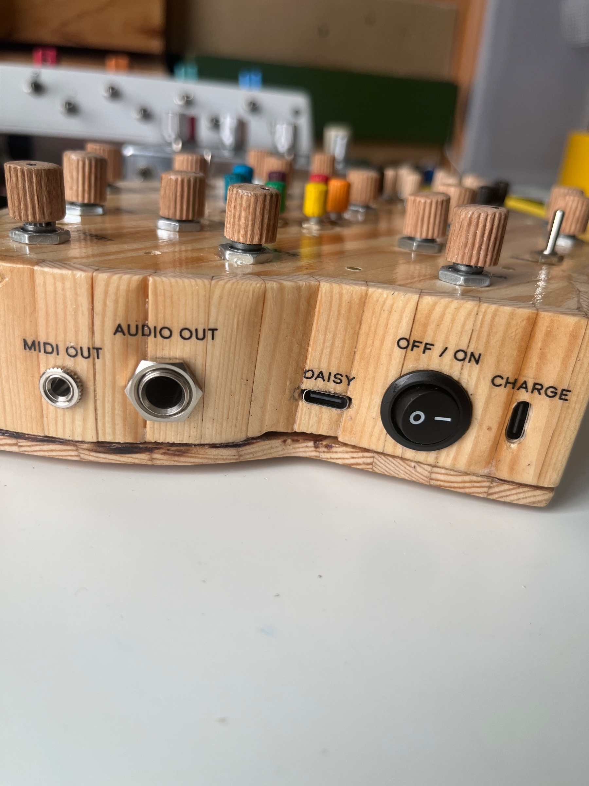
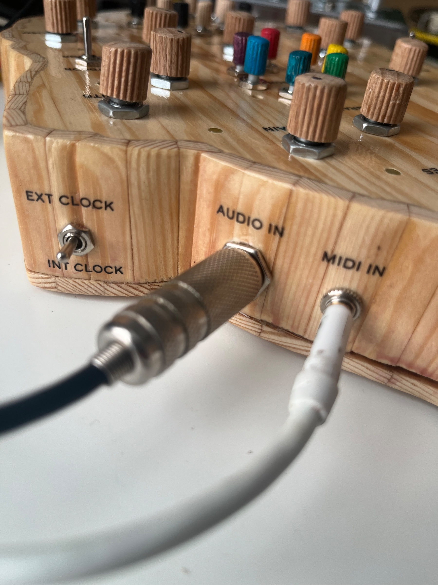
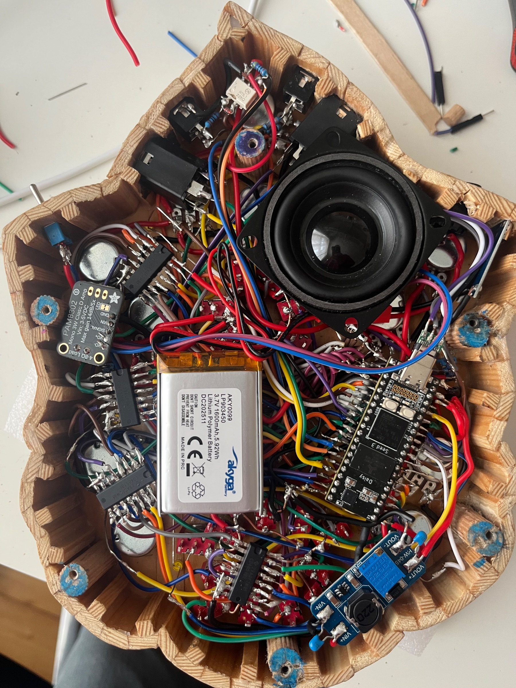

I could have been vibe coding a firmware for some random pocket synth, instead I spent the last 2 months creating this new machine.

Entirely programmed in plugdata.

It can generate complex melodies based on a series of parameters in a plant growing metaphor.

All the leds are directly connected to Daisy, while the buttons, pots and switches use 5 multiplexers (cd4021be).

Audio in/out; midi in/out; li-pol battery; internal speaker.

Super portable, super fun.
I love this plugdata-daisy framework: from idea to finish took me less then 2 months.
And this time I saved on knob caps and encosure 😁

Here’s a semi-long demo: https://youtu.be/T42-izEglRY?is=iK7CzBEPWlqaweoR

Here’s a mini ig video: https://www.instagram.com/reel/DerdN2dCbWS/?obrf=YWo0eGI0ZGZha2N1

